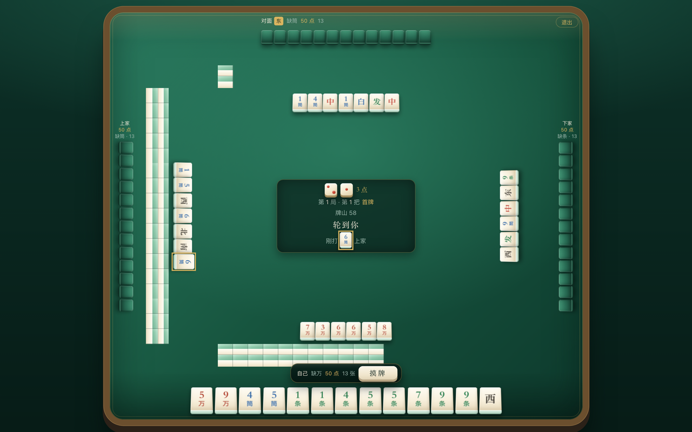
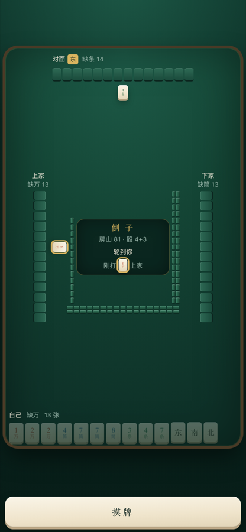
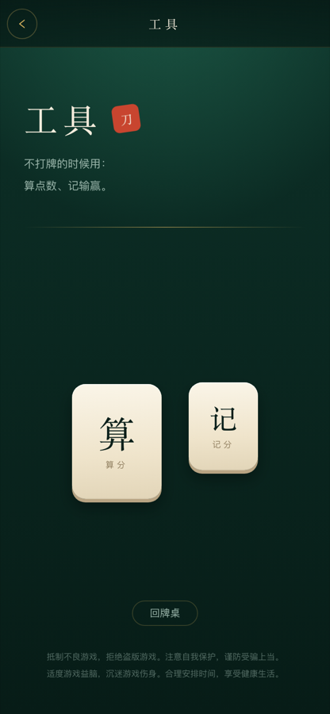
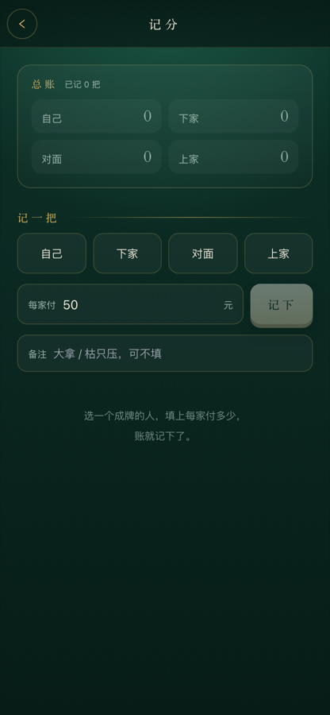
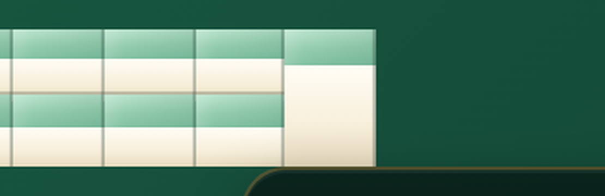
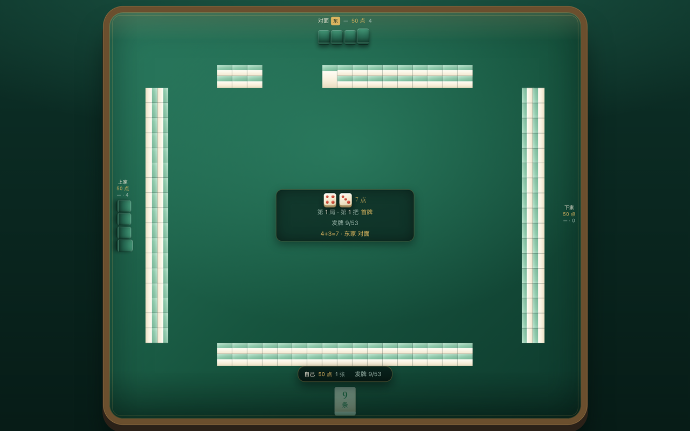
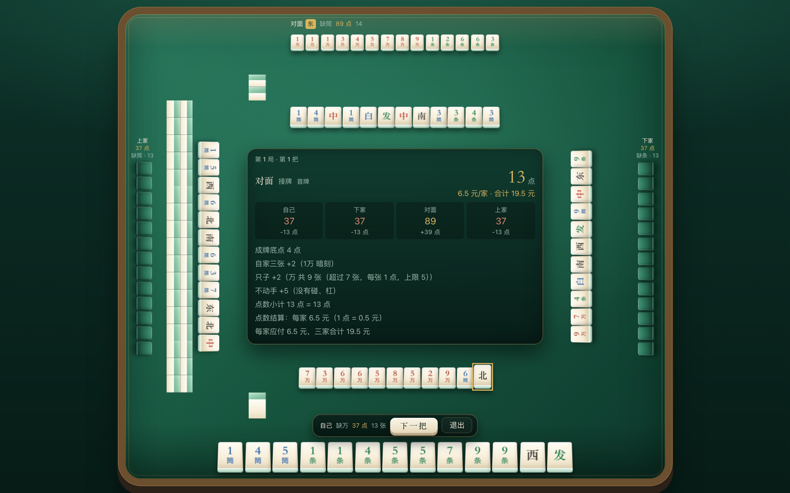

# 和县刀子 · 界面与开发说明

## 设计方向

**牌桌质感**：深毡绿底 + 象牙牌面 + 黄铜细线 + 朱红印章。这套界面是打牌时用的工具，
所以材料感来自牌具本身，而不是通用的浅色卡片风。

| 元素 | 用法 |
| --- | --- |
| 毡面 `.felt-bg` | 全局底色：中心柔光 + 底部压暗，模拟灯光下的牌桌 |
| 牌面 `.tile-face` / `.tile-face-sm` | 象牙渐变 + 下沿厚度，是整套界面的记忆点 |
| 黄铜 `.brass-card` / `.brass-rule` | 细线分组，不用毛玻璃和重阴影 |
| 牌型按钮 `.chip` / `.chip-on` | 未选是暗底细线，选中变成一张象牙牌 |
| 字体 | 标题用宋体系（`font-serif`，系统自带，离线可用），正文用系统无衬线 |
| 身份色 | 万朱、筒靛、条青、字墨，给牌面传统牌具的辨识度 |

动效只用在有意义的地方：首页入场错落（`.rise`）、牌面按压厚度变化、盖章的朱红印记（`.seal-in`）；
`prefers-reduced-motion` 下全部关闭。

## 页面

| 路径 | 页面 | 说明 |
| --- | --- | --- |
| `/` | 牌桌（主路由） | 全屏、不受工具页宽度限制。按 GPT 原型的排布：牌山内圈、牌河外圈、四家围坐；驱动 `src/game/game.ts` 状态机 |
| `/helper` | 工具入口 | 算分 / 记分两个入口，另有「回牌桌」 |
| `/helper/calculator` | 算分 | 手动勾选牌型的辅助工具，顶部常驻结果条 |
| `/helper/scoreboard` | 记分 | 按成牌者 + 每家付多少记流水，localStorage 持久化 |

主路由就是牌桌：`CommonLayout` 在 `/` 走 `.wide-shell`（全屏、无头部），
其它路由走 `.app-shell`（34rem 手机宽、带返回头）。牌桌右上角有「工具」入口。






## 牌桌的排布

从桌心往外三层：**中央面板 → 四条牌河 → 四面牌墙**，四家的手牌贴着桌边。

- **四条墙，不是一个方框**：`--ring-w`（横）和 `--ring-h`（竖）分开算。
  横向上左右两条墙贴着左右两家的手牌放（只留一条身位），上下两条居中，
  于是四角自然空出一截——真牌桌就是这样的四条杠，硬要围成一个方框只会四角互相压。
- **摸空的墩原位留空，不压缩**：17 墩按原位渲染，抓空的墩就是一块空占位（同尺寸、不画牌）。
  墙条锚在桌角那一端、只从抓牌的那一头变短——真牌桌上牌不会自己滑过去补位。
- **抓牌方向：顺时针、每面墙从右往左**。自己这面墙从牌面右边抓起，一墩一墩往左走，
  抓到头接左手边那面（上家），再往上是对面、右手边（下家），绕回自己这面。
  所以每面墙的墩号 16 都摆在「上家那头的角」上，四段墙的消耗前沿首尾相接。
- **留墩**：掷骰后按两颗骰子里较小的点数，在**开牌墙（骰子指向的那家）牌面右边**留几摞不动，
  发牌从再往左一摞开始（如 1+4 → 右边留 1 摞，从第 2 摞起从右往左发）。
  留墩排到整圈的最后才轮到——墙上只会看到「留墩在最右端 + 中间被吃掉的一段 + 剩下的墙」，
  不会中段凭空空一段。
- **整圈牌墙是一条连续的牌**：发牌和打牌都从同一个墙头连续取，抓完这面接着下一面，
  **不是每家回头去抓自己门前那面**。所以墙上只会在「已经抓到哪儿」这一个地方出现空档，
  空档是一段连着的弧，不会四面各缺一段。
  发完牌 53 张 = 26.5 墩，超过一面墙的 17 墩，所以开牌那面必然被抓掉大半、下一面吃掉一半
  （扣掉留墩后剩 83 张），这是「从一头连续抓」必然的样子。
- **牌墙外圈**：四面各 17 墩 × 上下两层，共 136 张。
  `--wall-w = min(--ring-w, --ring-h) / 20`——一墩按 1/20 边长的正方形打底，
  但因为它是**躺着的**牌，看到的除了牌背还有它自己的厚度，所以一墩比正方形高 50%（`--wall-tall`）。
  每面墙「1 墩上、1 墩下、2 墩上、2 墩下……」一墩一墩地抓，不是先把整面墙的上层抓完。
- **牌山的画法**：一墩两只牌，**前后叠放**（2.5D 俯视）。每张牌 = 淡绿顶面（`.wall-tile-face`）
  + 象牙侧厚（`.wall-tile-side`），**都是正正经经的矩形，不切斜、不错位**。
  后层（`.wall-tile.is-back`）占墩的上半，前层（`.wall-tile.is-front`）占下半、压住后层的下缘，
  所以一墩从上到下是「绿 / 白 / 绿 / 白」，两层各自露出一段完整的「绿 + 白」，一眼读出是两只牌。
  **按物理牌面配色：白多绿少**——躺着的牌看到的主要是象牙侧厚，绿顶面只占一条
  （占墩高：后层绿 20 / 白 32 + 前层绿 24 / 白 28，整墩白约 58%）。
  牌与牌之间不留缝，只在每张右缘压一道 1px 暗线当砖缝。竖着的两面墙整块转 90°（`.wall-body`），
  牌跟着转，四面的堆叠看起来完全一致。
  **摸走一只就少一只**：摸走一只后，这一墩改成「**一整只牌铺满整格**」（`.wall-tile.is-solo`）——
  绿顶面只剩一条（26%）、象牙侧厚占满其余（74%），所以牌墙的外形始终是一整条，
  墩里不会留半格空洞；两只都摸走才整个空出来。
  （早先的写法是「只剩哪层就只画哪层」，那一层只占整墩 52%，于是横墙缺下半截、竖墙缺半边，
  看着就是「上方有牌、下方没牌」——已改掉。）
  （更早还给整张牌加过 `skewX(-12deg)`、后层再 `translateX(10%)` 做纵深，结果牌是斜的、锯齿边，
  两层在墙的端头各错出一截，竖墙转 90° 后错位变成纵向——看着就是每面墙都缺一块，已全部去掉。）
- **牌面的底**：所有牌（手牌、牌河、副露）都是象牙牌面 + 淡青玉的厚度底（`.tile3d-side`），
  跟真牌的青底一个意思。


- **留墩**：开牌那面墙按两颗骰子里较小的点数留墩（`breakStacks`），这几墩排在抓牌队列的末尾，
  自然最后才轮到——所以它不会在墙上挖出中段空档。抓牌起点由骰子定的开牌墙（`wallSeat`）决定。
- **牌河**：贴在墙内侧，四家各一条，牌紧挨着并列不留缝；我和对门横着摆（每行最多 13 张），
  上下家竖着摆（每列最多 13 张），超过就换行/换列。**四条牌河一律居中**（`justify-content:center`
  + `align-content:center`，外层容器也居中）——早先是「横向 flex-start、竖向 items-start」，
  结果上家和自家看着靠左、下家和对门靠右，四家不一样齐。
  **换行一律朝桌心长**：自家和下家的牌河贴着自己那一边，用 `flex-wrap-reverse`（`wrapReverse`）
  把第二行甩到靠桌心的一侧；对门和上家本来就是往桌心长的，用默认 `wrap`。
- **左右两家整家旋转 90°**：手牌、牌河、副露都侧着摆，跟真实码牌一致（左家 +90°、右家 −90°，朝桌面中心）。
- **副露放在各自手牌右手侧**：左右以「从桌心往这一家看过去」为准，所以对面在屏幕左、上家在屏幕下、下家在屏幕上。
- **中央**：骰子、牌山剩余、轮到谁、接牌按钮（碰/杠/成/过）都在这里。骰子只在掷的那一下放大，
  停下来缩到 `--ring-h` 的 4%（一颗约 25px），点数就留一行「N 点」小字——点数已经不重要了，
  把位置让给别的东西。提示文字反过来字号加大：局/把 11px、牌山 11px、「轮到你 / 选缺门」15px 衬线。
- **结算**：成牌后不在中央面板里挤，另起一张结算牌摊在桌心，点数用 30px 大字，
  下面四格写四家的剩余点数与增减，再列明细。赢家的手牌按牌序排好亮出来，成牌张单独放在最右。
- **操作条**：定缺 / 摸牌 / 出牌 / 下一把 / 本局结束浮在手牌上方、牌墙下沿的桌面上，不再压到牌墙或牌河。
- **自己的手牌**：手里还有缺门牌时，缺门牌高亮（黄铜描边 + 柔光）、其余一律置灰不可点。
- **桌沿外的一圈空白**：`measure()` 按窗口短边的 2.4% 先扣掉一圈余量再算桌面尺寸，
  桌沿的木边和外投影才有地方落，不会顶死到窗口边缘（实测 1032×872 下四边余 39/25px）。

### 2.5D 是怎么做的

不是把桌面斜过来，而是**每一张牌自己是立体的**：牌面按 `perspective(240px) rotateX(20deg)`
往后仰、牌底再贴一道更暗的侧边（`.tile3d-side`），镜头等于从斜上方看下来，
所以每张牌是上窄下宽的梯形、带一圈厚度，牌墙的每张牌也有自己的厚度边。

### 发牌流程

1. **掷骰子**：两颗骰子在桌子中间滚 0.95 秒，点数一直在跳，停下来才定。
2. **定开牌墙**：点数之和相对掷骰者数座位（5=自己、6=下家、7=对面、8=上家），
   点数指向的那家那面墙开牌。东家不动——东家就是掷骰的人（上一把成牌的人）。
3. **发牌**：东家起顺时针，一次抓 2 摞（4 张）给一家，转 3 轮；
   然后东家跳牌——抓 1 张、跳过下面那张直接拿下一墩的上层（凑 14 张），其余三家各补 1 张（各 13 张）。
   跳过的那张留在墙上，所以开牌那面墙会留两道半高的墩，之后摸到那儿才被摸走。
4. 发牌动画逐张推进（4 张一把抓得快、单张慢一点），牌墙一格一格少下去，四家手牌一张一张长出来，
   中央显示 `发牌 x/53`；发完自动进入定缺。

发牌顺序只有一份：`src/game/table.ts` 的 `dealPlan` 给出「谁、几张、跳几格」，
`dealTrace` 把它摊成逐张的「给谁、从牌墙第几格抓」；引擎发牌和界面动画都吃这一份，
测试里直接比对四面墙各少了多少张，两边对不上就会红。



### 一局是怎么走的

打牌不是一把一把单算钱，而是**一局 50 点、逐把转移**：

1. 每把按结算结果转移点数：普通成牌三家各付 `min(成牌点数, 自己剩余点数)`，
   大拿则三家点数直接清零；
2. 每把同时记金额（`money`），但**不当场收钱**：本把结算卡在本局未结束时只显示点数（
   「本局未结束 · 只结算点数」），不出现「元/家」；点数付完、本局结束的总账才亮金额；
3. 谁的点数先被付完（≤ 0），这一局就结束——把本局金额记进总账（`totalMoney` / `history`），
   下一局四家重新 50 点；
4. **每局第一把算「首牌」**，首牌大拿就命中清水（1 大摸子 + 1 小摸子 = 1.5），
   所以「记点数」这件事本身就是清水能不能出来的前提。

界面上：中央面板常驻 `第 N 局 · 第 M 把`，首牌时多一个「首牌」小标；
每家名字下面挂着自己的剩余点数；局末弹一张总账，写清四家本局输赢和累计。



这一层在 `src/game/match.ts`：`createMatch` → `startHand`（自动带 `isFirstHand = hands === 0`）
→ `endHand` / `applyHandSettlement`。牌桌页只用这四个函数，单把的状态机仍在 `game.ts` 里。

> 单人演示里座位固定，`endHand(match, { rotate: false })` 不调圈（否则「自己」会换到别的位置，
> 整个桌面布局都要跟着转）；`rotate: true` 时打满 4 局会按 `rotateSeatsAfterRound` 调圈。

尺寸不写死：`src/pages/index/index.tsx` 用 ResizeObserver 量出可用的宽高，算出基准 `--bw`
写到牌桌上，所有牌（手牌 `--t-hand`、座位 `--t-seat`、牌河 `--t-discard`、副露 `--t-meld`、
牌山 `--wall-w`、牌圈边长 `--ring`）都按这个基准取比例，
所以手机竖屏和桌面宽屏是同一张桌子，只是整体缩放；竖屏时桌面高度也会收一收，不会拉成一长条。

算分页的牌型与分值来自 `src/game/manual.ts`，而它读的是 `score.ts` 里的 `DEFAULT_RULES`，
所以规则改了页面不会留下过期数字。

## 已修的布局根因

原来的 `ResizeDetection` 按 `clientWidth / 375` 缩放根字号——在 1440px 的桌面上字号会被放大到 61px，
所有间距、按钮、卡片跟着膨胀三四倍，这就是「布局有点奇怪」的来源。
现在它只写一个 `--app-vh` 变量来修正移动端 100vh 偏差，排版交给正常响应式；
主列 `.app-shell` 在桌面端收在 34rem 居中。

后面几轮又挖出三个同类的「看着像排版、其实是数据」的问题，记在这里免得再踩：

| 现象 | 根因 | 改法 |
| --- | --- | --- |
| 牌山总有一两面被摸空 | 一面墙先铺满上层再铺下层，抓牌又走全局池，于是一面先耗尽 | `buildWallSide` 按墩交错（上、下、上、下），每家只从自己那面墙摸 |
| 抓牌「先把上面一行抓完」 | 同上：索引 `i` 直接当牌位，`i < 17` 全落在上层 | `col = floor(i / 2)`、`layer = i % 2`，上下上下地抓 |
| 一墩「上方有牌、下方没牌」 | 只剩一只时只画剩下的那一层，而单层只占整墩 52%，另一半就是空的 | 单只改画 `.wall-tile.is-solo`：一只牌铺满整格（绿 26% + 白 74%） |
| 牌河第二行往家里长 | `flex-wrap` 默认朝 cross-start（贴着玩家的那一侧）换行 | 自家/下家加 `wrapReverse`，第二行甩到桌心那侧 |
| 结算卡片跑到牌桌右下角 | `.settle-in` 的 `@keyframes` 里写了 `transform: scale()`，把内联的 `translate(-50%,-50%)` 覆盖掉了 | 外层只负责定位，内层负责动画，两层各管一件事 |

## 本地开发

依赖要用 **pnpm 7** 安装（`pnpm-lock.yaml` 是 lockfileVersion 5.3，pnpm 10 会拒绝）：

```bash
node "$(dirname "$(command -v node)")/../lib/node_modules/corepack/dist/corepack.js" pnpm@7.33.7 install
pnpm dev        # 开发
pnpm build      # vue-tsc --noEmit && vite build（tsconfig 的 types 里要有 "vue/jsx"，否则 JSX 全报 TS7026）
pnpm test       # 结算引擎 + 对局状态机
```

## 无头浏览器校验

界面改动可以不开浏览器直接量：`scripts/inspect-page.mjs` 通过 Chrome DevTools Protocol
设置视口、跑表达式（可点击交互）、截图。先起一个**独立端口**的无头 Chrome：

```bash
"/Applications/Google Chrome.app/Contents/MacOS/Google Chrome" \
  --headless=new --remote-debugging-port=9333 --user-data-dir=/tmp/cdp-daozi about:blank &

# 量布局（默认输出视口宽度、是否有横向溢出等）
CDP_WIDTH=390 node scripts/inspect-page.mjs "http://localhost:5199/#/"

# 整页截图
CDP_WIDTH=390 CDP_HEIGHT=844 CDP_FULL=1 CDP_SCREENSHOT=/tmp/table.png \
  node scripts/inspect-page.mjs "http://localhost:5199/#/"

# 自动打一整把牌（掷骰子 → 选缺门 → 摸打 → 碰/杠/成 → 结算），
# 结束后输出流水、结算明细和控制台报错数；CDP_SCREENSHOT 可存终局截图
CDP_WIDTH=1280 CDP_HEIGHT=800 CDP_MAX_MS=600000 CDP_SCREENSHOT=/tmp/settle.png \
  node scripts/autoplay-game.mjs
```

注意别用 9222 端口——本机上其它应用（Motrix、MQTTX 等）已经在用，连上去会操作到别人的窗口。
