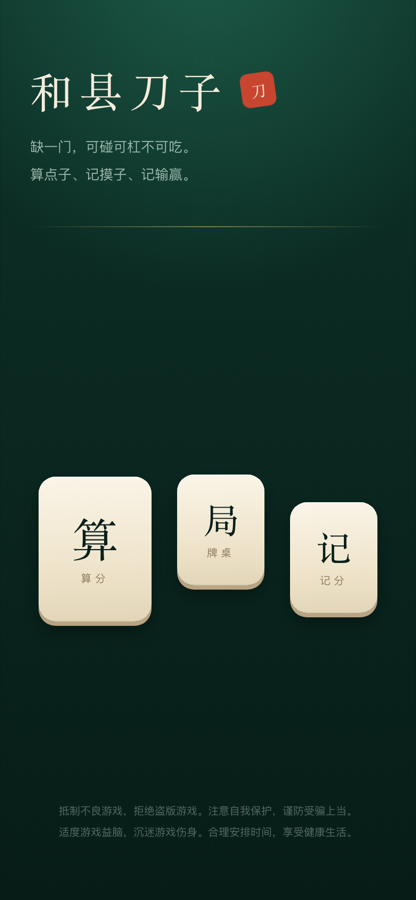

# 和县刀子 · 界面与开发说明

## 设计方向

**牌桌质感**：深毡绿底 + 象牙牌面 + 黄铜细线 + 朱红印章。这套界面是打牌时用的工具，
所以材料感来自牌具本身，而不是通用的浅色卡片风。

| 元素 | 用法 |
| --- | --- |
| 毡面 `.felt-bg` | 全局底色：中心柔光 + 底部压暗，模拟灯光下的牌桌 |
| 牌面 `.tile-face` / `.tile-face-sm` | 象牙渐变 + 下沿厚度，是整套界面的记忆点 |
| 黄铜 `.brass-card` / `.brass-rule` | 细线分组，不用毛玻璃和重阴影 |
| 牌型按钮 `.chip` / `.chip-on` | 未选是暗底细线，选中变成一张象牙牌 |
| 字体 | 标题用宋体系（`font-serif`，系统自带，离线可用），正文用系统无衬线 |
| 身份色 | 万朱、筒靛、条青、字墨，给牌面传统牌具的辨识度 |

动效只用在有意义的地方：首页入场错落（`.rise`）、牌面按压厚度变化、盖章的朱红印记（`.seal-in`）；
`prefers-reduced-motion` 下全部关闭。

## 页面

| 路径 | 页面 | 说明 |
| --- | --- | --- |
| `/` | 首页 | 品牌 + 三个「牌」入口（牌桌 / 算分 / 记分） |
| `/table` | 牌桌 | 按 GPT 原型的排布：牌山内圈、牌河外圈、四家围坐；驱动 `src/game/game.ts` 状态机 |
| `/calculator` | 算分 | 手动勾选牌型的辅助工具（原型路子之外的参考），顶部常驻结果条 |
| `/scoreboard` | 记分 | 按成牌者 + 每家付多少记流水，localStorage 持久化 |





## 牌桌的排布（对齐原型）

- **牌山内圈**：四面墙固定 17 墩，摸掉的墩留空位，所以牌圈大小不会随牌数变化；
  先取上层再取下层的两层墩、只剩一只时画半截。
- **牌河外圈**：四家各一条，牌**紧挨着并列**不留缝；我和对门横着摆（每行最多 14 张），上下家竖着摆（每列最多 14 张）。
- **左右两家整家旋转 90°**：手牌、牌河、副露都侧着摆，跟真实码牌一致（左家 +90°、右家 −90°，朝桌面中心）。
- **座位**：对门在上、上下家在左右、自己在最靠近桌边的一侧；碰杠出的牌放在各自手牌右手侧、翻出来显示。
- **桌面最近打出的一张牌**有黄铜描边标记，中央另外写一行「刚打 × 谁」。
- **自己的手牌**：手里还有缺门牌时，缺门牌高亮（黄铜描边 + 柔光）、其余一律置灰不可点，标题也提示「必须打缺门牌」。
- **中央**：牌山剩余、骰子、轮到谁、接牌按钮（碰/杠/成/过）都在这里；成牌后中间直接铺结算明细，并把赢家的牌亮出来。

尺寸不写死：`src/pages/table/index.tsx` 用 ResizeObserver 量出可用的宽高，算出基准 `--bw`
写到牌桌上，所有牌（手牌 `--t-hand`、座位 `--t-seat`、牌河 `--t-discard`、副露 `--t-meld`、
牌山 `--wall-w/--wall-h`、牌圈长度 `--ring`）都按这个基准取比例，
所以手机竖屏和桌面宽屏是同一张桌子，只是整体缩放。

算分页的牌型与分值来自 `src/game/manual.ts`，而它读的是 `score.ts` 里的 `DEFAULT_RULES`，
所以规则改了页面不会留下过期数字。

## 已修的布局根因

原来的 `ResizeDetection` 按 `clientWidth / 375` 缩放根字号——在 1440px 的桌面上字号会被放大到 61px，
所有间距、按钮、卡片跟着膨胀三四倍，这就是「布局有点奇怪」的来源。
现在它只写一个 `--app-vh` 变量来修正移动端 100vh 偏差，排版交给正常响应式；
主列 `.app-shell` 在桌面端收在 34rem 居中。

## 本地开发

依赖要用 **pnpm 7** 安装（`pnpm-lock.yaml` 是 lockfileVersion 5.3，pnpm 10 会拒绝）：

```bash
node "$(dirname "$(command -v node)")/../lib/node_modules/corepack/dist/corepack.js" pnpm@7.33.7 install
pnpm dev        # 开发
pnpm build      # vue-tsc --noEmit && vite build
pnpm test       # 结算引擎 + 对局状态机
```

## 无头浏览器校验

界面改动可以不开浏览器直接量：`scripts/inspect-page.mjs` 通过 Chrome DevTools Protocol
设置视口、跑表达式（可点击交互）、截图。先起一个**独立端口**的无头 Chrome：

```bash
"/Applications/Google Chrome.app/Contents/MacOS/Google Chrome" \
  --headless=new --remote-debugging-port=9333 --user-data-dir=/tmp/cdp-daozi about:blank &

# 量布局（默认输出视口宽度、是否有横向溢出等）
CDP_WIDTH=390 node scripts/inspect-page.mjs "http://localhost:5199/#/table"

# 整页截图
CDP_WIDTH=390 CDP_HEIGHT=844 CDP_FULL=1 CDP_SCREENSHOT=/tmp/table.png \
  node scripts/inspect-page.mjs "http://localhost:5199/#/table"
```

注意别用 9222 端口——本机上其它应用（Motrix、MQTTX 等）已经在用，连上去会操作到别人的窗口。
