# 倒子麻将 · LayaAir 版

把 web 端（`src/`）的牌桌玩法完整迁移到 LayaAir 3.4，一套代码同时跑浏览器和微信小游戏。

**运行模式**：默认 2D 平面牌桌；地址栏加 `?3d=1` 切到 3D 牌桌，`?2d=1` 显式指定 2D。

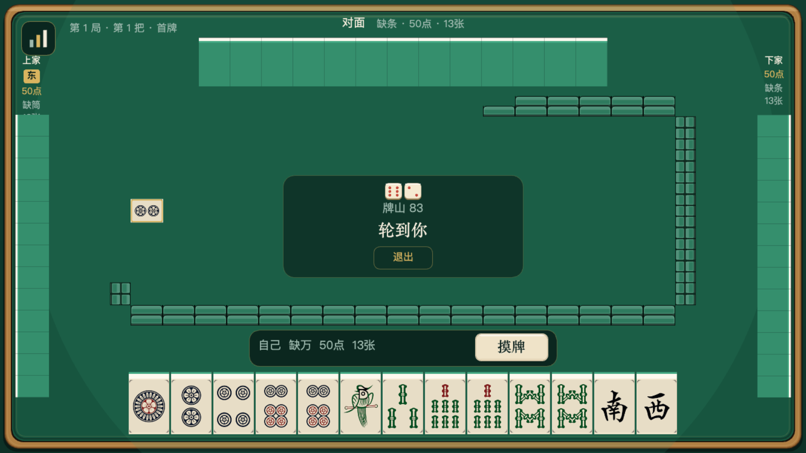

成牌结算卡：大拿徽标在「自摸/接牌」右边，牌型明细一行铺开并给出小计，点数和金额都对得上。

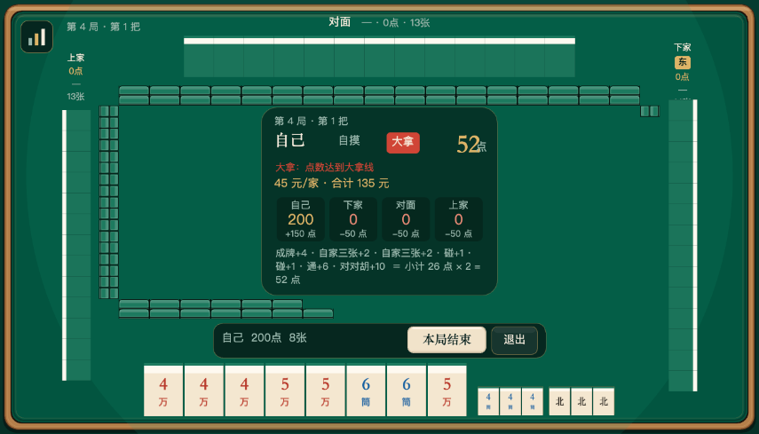

| 横屏 · 3D 牌桌（手机默认） | 横屏 · 3D 结算 |
| --- | --- |
| 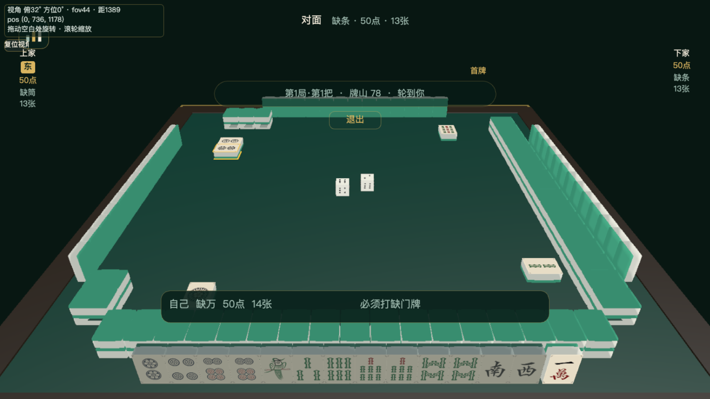 | 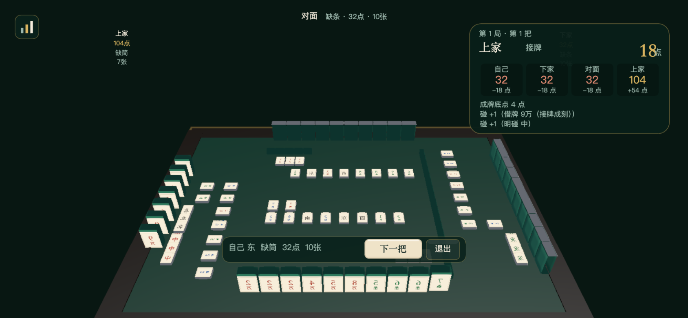 |

| 累计战绩 / 本地存档 | 退出确认 |
| --- | --- |
| 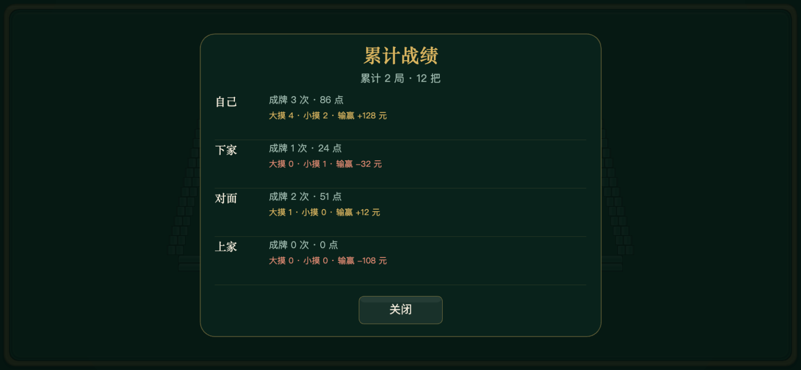 | 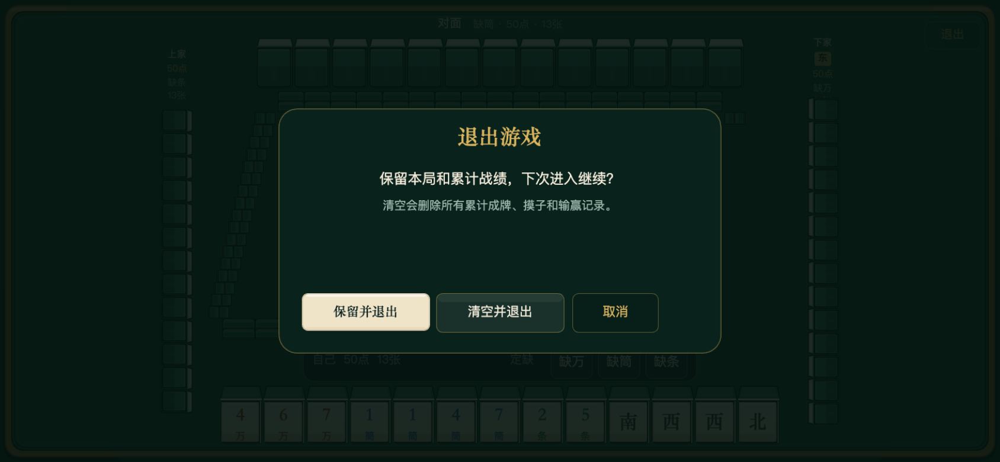 |

| 手机竖着打开（3D 横屏布局，侧放） | 手机逆时针转 90° 后 |
| --- | --- |
| 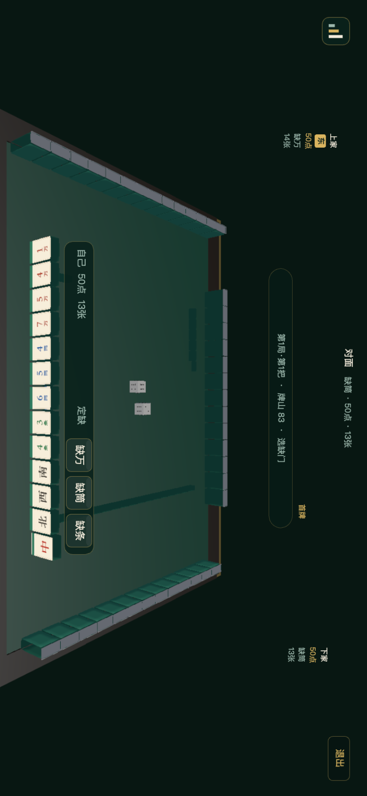 | 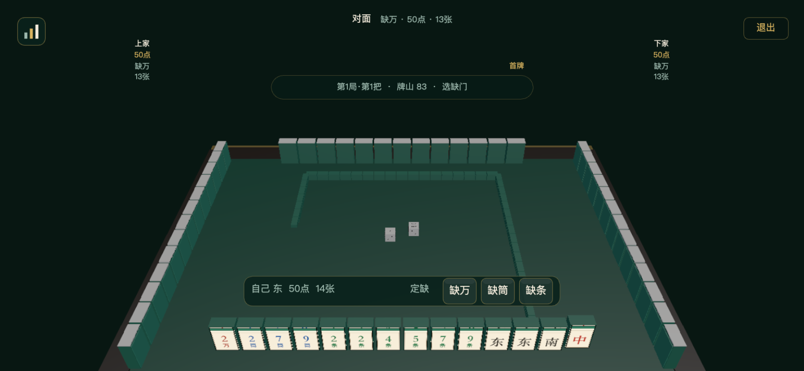 |

| 竖屏 · 桌面窗口 | 自摸成牌：成 / 打 |
| --- | --- |
| 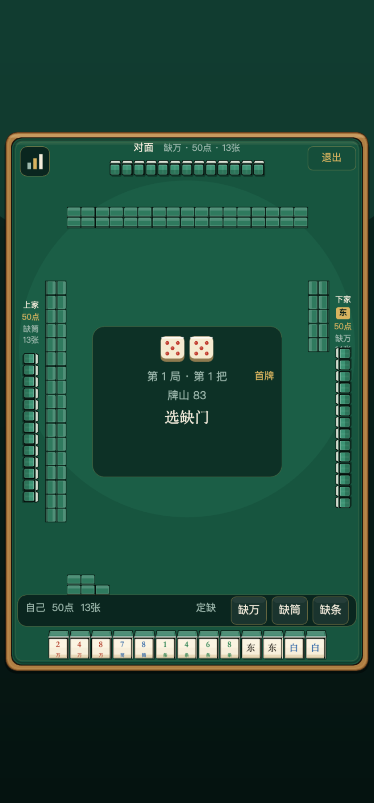 | 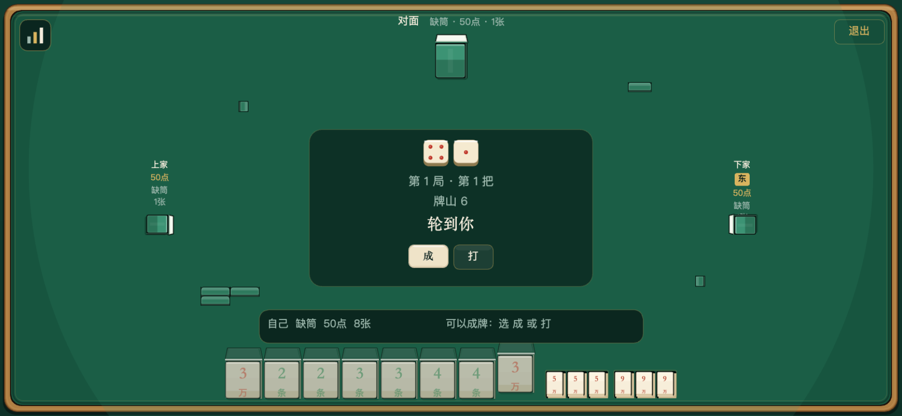 |

## 已实现

- **横屏全屏**：手机 / 微信小游戏始终按横屏布局，以 750 设计高铺满屏幕；本家和对家手牌放大，上家/下家手牌缩小，横屏也排得下。手机竖着拿时整个牌桌根节点旋转 90°（不依赖 `screenMode` 和系统自动旋转），打开就是横屏牌桌，不会被压成竖条，也不弹「请横屏」；画面侧放，逆时针转手机即可。微信由 `game.json` 锁定横屏。桌面竖屏窗口保留竖屏布局。
- **掷骰开局**：两颗骰子滚动动画，按点数和定开牌墙、留墩；东家＝掷骰者（成牌者坐东），不随点数改。
- **发牌动画**：53 张逐张发到四家，牌墙按实际抓走的位置实时变短，庄家跳牌留缺口。
- **定缺**：三家 AI 自动定缺，玩家点「缺万 / 缺筒 / 缺条」。
- **三打一翻牌**：四家定缺后若三家同缺一门，缺另一门的那家要把**三家缺的那一门**翻开——
  2D / 3D 里只有这一门的牌背换成牌面，其余手牌仍然扣着，之后摸到的这一门也一直亮着；
  座位标签和中央提示标出「亮万 / 亮筒 / 亮条」，定缺刚结束时顶部弹一次提示。
  该家成牌照旧 +5 点、1 个小摸子；四家同缺或两两不同不触发。
- **听牌喊听**：三打一的亮牌方一旦听牌，手牌前面会出现红框红字的「听」标记
  （2D 浮在牌前，3D 是桌上的一块平躺「听」牌），同时顶部喊一声「下家听牌！」/「你听牌了」。
- **摸打**：摸牌、手牌排序、刚摸到的牌单独抬到最右；有缺门牌时只能打缺门牌并高亮。
- **自摸成牌**：摸到成牌张后不自动成牌，中央出现「成 / 打」；选成结束本把，选打再点一张手牌继续。
- **杠**：手里四张可暗杠，碰过的牌摸到第四张可加杠；杠后从牌尾补一张，补牌成牌可杠开。按钮会显示「杠2万」。
- **碰 / 杠 / 成 / 过**：接牌优先级、杠后补牌、碰完立即出牌，全部沿用 web 引擎。
- **大吊车禁打**：禁打牌用红框标出，打出禁牌会记录并在成牌时算点炮。
- **结算**：成牌底点、对子、只子、通、连号、棒棒、四活、不动手、草一色、对对胡、七对、大吊车、老小对、三打一、杠开、杠后赛花、枯只压、清水、大拿、摸子，全部由 `src/game/score.ts` 原样计算；杠后赛花有独立徽标。
- **大吊车禁打提示**：打出禁牌会被红框标出，操作条同时显示禁打范围和「打出算点炮」文案。
  - 一局还没结束时，结算只显示点数与点数明细，不显示金额；只有本局结束（有人点数被付完）时才显示每家金额，随后进入总账。
  - 横屏结算按内容收窄、压矮，只显示成牌家、点数、四家点数增减、最多 4 条关键牌型；四家的亮牌都露在面板外。
  - 接牌成刻：对倒听牌时别人打出其中一张凑成刻子，这一组按碰 1 点算（借牌），其余暗刻仍 2 点；自摸仍是 2 点。
- **局流程**：一局 50 点，点数被付完本局结束，弹总账（本局 / 累计），可开下一局；四局调圈（第 4、8…局结束，最后由成牌的人掷骰换位）在游戏里真实生效。
- **3D 牌桌**：桌面、木沿、牌墙、四家手牌 / 副露 / 牌河、两颗骰子全部是 3D 网格；相机默认在本家后上方（俯 32°、距离 1310、fov 44），近大远小。3D 场景先渲染到 `RenderTexture`，再铺到 2D 根节点，所以竖屏旋转时 3D 画面和 2D 按钮 / 文字会一起转。
- **可调视角**：拖动空白处绕桌旋转、滚轮缩放、左上角「复位视角」回默认；左上角同时贴着当前 `俯角/方位/fov/距离/相机坐标`，找到满意的位置后照抄这组数值改 `DEFAULT_CAM_*` 就能固定下来。
- **2D 交互层**：按钮、提示、战绩 / 结算面板仍然是 2D；手牌点击区域由 3D 世界坐标投影回 2D，可打 / 禁打 / 必须打缺门仍用 2D 描边。最后打出的牌只在 3D 牌河上套黄色描边，不再显示“刚打某家”。
- **更小的中央提示**：中间只保留一条窄状态条，不再用大面板挡住牌河；成 / 杠 / 碰 / 过按钮收进底部操作条。3D 结算卡贴右上/左上放，给对家亮出的牌面让出中央。
- **骰子**：两颗 3D 骰子，滚动时大、落定后缩小；不再显示 2D 骰子。
- **3D 牌面**：牌是带厚度的 3D 圆角长方体（12 条棱、8 个角都做圆弧），牌面是一张真实麻将牌贴图；牌与牌之间只留极小间隙，不再每张牌套一圈黑边。本家牌面朝向相机，对家 / 左右家背面朝相机，亮牌时翻到正面。
- **真实牌面贴图**：34 种牌（万 / 筒 / 条的 1–9，东南西北中发白）不再用「二 + 万」这样的文字拼牌，
  全部换成真实牌面图案：万是书法数字 + 萬，筒是饼花，条是竹节（1 条是长尾雀鸟），
  字牌是東南西北中發白（白板留白加黑框）。
  2D 和 3D 共用同一张 `resources/tiles/tilefaces.png`：1024×880、每格 128×176、量化到 128 色后只有 **92KB**。
  牌的宽高比固定按贴图的 128:176 来：2D 贴图只铺满厚度带下面的牌面（0, faceY, w, faceH），
  立牌另外加一条厚度带（带宽 18% 牌宽，带内白 70% + 绿 30%），所以立牌整体高宽比是 1.375 + 0.18。
  3D 牌高由牌宽反推（54 × 176/128 = 74.25），贴图面和牌体同宽同高、同圆角，正面不再留白边。
  - 自家：厚度带在顶部，绿在上（靠背）、白在下（靠牌面）；
  - 对家：白在上、绿在下（绿靠着牌背），下面是深一档的绿牌背；
  - 上家：从左往右是白、绿、深绿牌背；下家：从左往右是深绿牌背、绿、白；
  - 牌河 / 副露等平躺的明牌：从顶部看只能看到顶面，所以不画厚度带，贴图直接铺满；
  - 牌背的绿比顶部厚度带更深一点，模拟背面受光少。
  2D 直接用图集子纹理，3D 按格裁到 Canvas 再上传成 `Texture2D`；禁打的牌在贴图上压一层灰，
  图集加载失败 / 超时则自动退回原来的文字牌面。牌面取自
  [zddd312/mahjong-tiles](https://github.com/zddd312/mahjong-tiles) 的扁平风格套装
  （M+ 字型条款，可自由商用；它本身由 lietxia/mahjong_graphic 与 I.Mahjong 整理而来），
  按牌桌的象牙底色重新合成，并裁掉了原图外层的灰边（许可全文见 `docs/tilefaces-license.md`）。

  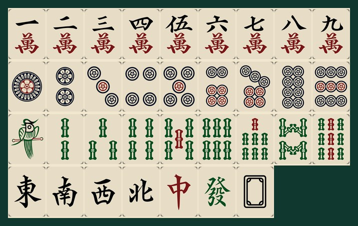
- **全桌只有一种牌模型**：每张牌都是同一块圆角长方体 `54 × 74.25 × 26`，
  由两段拼成——厚度方向靠**背面 30%** 是玉绿 `#4CAF87`（牌背），靠**正面 70%** 是象牙白（牌身）。
  - 所以同一张牌，站位不同看到的不同：**朝向自己的牌看到白色牌面；别人家的牌看到绿色牌背，
    牌顶上是一条绿 + 一条白。**
  - 立着（手牌）、平躺牌面朝上（牌河 / 副露）、平躺牌背朝上（牌墙）三种摆法都走同一个函数，
    只是整组先绕 X 轴翻倒、再水平转向（拆成内外两个节点做，旋转顺序才确定）。
  - **踩过的坑**：牌面贴图里一度又画了一条绿顶带，于是手牌顶上同时有贴图的绿和牌背的绿，
    看着就是「两种绿」；侧家手牌的白面又没朝对方向，屏幕上是一大片白。
    现在贴图里只有牌面、绿背只由牌体提供，朝向也按「白面朝主人」排好了。
- **牌墙**：一墩就是两张平躺的牌叠在一起（牌背朝上），和手里的牌**同一套尺寸和同一套模型**。
  17 墩 × 墩距 60 = 1020，牌宽 54，所以每墩之间空 6 的缝，能一墩一墩数出来；
  早先牌墙单独做成 34 × 18 × 11 的细条，比手牌小一半，而且 17 墩挤在一起看不见缝。
- **整体提亮**：场景自带的环境光 (0.42,0.46,0.53) 偏暗，运行时改写为 (0.72,0.76,0.78)、
  平行光 intensity 1.35、材质 albedoIntensity 1.15；桌面同时压暗到 #0F3D31，牌墙 #35916D、
  牌背 #4CAF87、白身象牙，四层亮度递增，牌和桌面不再粘在一起。
- **累计战绩 / 存档**：左上角图表图标打开累计战绩（每家成牌次数、成牌点数、大/小摸子、输赢金额）。右上角退出会询问「保留并退出 / 清空并退出」；保留会把当前牌局和战绩写入 LayaAir / 微信本地存储，下次进入从当前继续；清空等于重置。
- **牌墙消减**：摸走哪一层就空哪一层；只剩上层 / 只剩下层时只占半格高度，墙上会留下真实缺口。
- **手牌**：四家手牌紧挨排列，牌体圆角、间隙极小，既有分隔又不会散开。
  四家离桌沿统一留一张牌厚（28，牌体中心 = 桌沿 - 28 - 14）；早先自家留 120、其它三家只留 4~22，
  近处的自己离桌边特别远，另外三家却卡在桌沿上。刚摸到的牌只往右让一点，底部仍和手牌齐平。
- **牌背渲染坑**：对家 / 左右家的牌背直接用亮一档的绿牌体（#3C9374），不再贴薄面板——
  薄面板（厚 1.7）一旦套 BlinnPhong 材质，法线在厚度上退化，**整组手牌会一起不渲染**；
  UnlitMaterial 不受影响。想给牌背加贴图，得走 Unlit 贴图管线。
- **牌河 / 副露**：打出去的牌和碰杠亮出的牌同样无缝排列——列距 = 牌宽（38）、行距 = 牌深（50），
  跟手牌同一套步长；左右家整块转 90° 后宽深互换，仍按这两个步长走。早先牌河用的是 52 的固定步长，
  比牌宽多出 14，看着一张一张散开。
- **界面**：深毡绿牌桌、象牙牌面、黄铜描边、朱红骰点；按钮保留牌面/描边两种质感。

## 语音播报

打牌、对（碰）、杠、暗杠、自摸、胡、抢杠、听牌、流局，以及 21 种牌型都有中文播报（连号、不动手不播）；
成牌会按「自摸 → 牌型 → 大拿」自动组合，越大的牌情绪越高。

**试听**：[▶ 23 秒串烧](docs/voice-demo.mp3)（单张报牌 / 对、杠 / 自摸清一色 / 自摸枯只压 / 自摸对对胡大拿 / 杠后赛花 / 三打一 / 抢杠胡）

| 场景 | 播报 |
| --- | --- |
| 打牌 | 一万、五筒、幺鸡、东风、红中、白板 |
| 对（碰）/ 杠 / 暗杠 | 对、杠、暗杠 |
| 普通自摸 | 自摸 |
| 自摸 + 清一色 | 自摸清一色（整句，无停顿） |
| 自摸 + 枯只压 | 自摸枯只压（整句，无停顿） |
| 自摸 + 对对胡 + 大拿 | 自摸对对胡大拿（整句，无停顿） |
| 杠后补摸 + 清一色 | 杠后赛花清一色（不喊自摸） |
| 抢杠 + 对对胡 | 抢杠胡对对胡 |

- 34 张牌名（1 条读「幺鸡」）+ 8 个动作 + 21 个牌型 + 20 个常见整句组合，共 **179 段 mp3、1.1MB**。
- 三档情绪：平播 / 提气 / 爆发；成牌整条共用一档，大拿单独用爆发档并压轴。
- 自摸永远第一；自摸和杠后赛花互斥；一条播报最多 5 段。
- **常见组合整句合成**（自摸清一色、自摸枯只压、自摸对对胡大拿、杠后赛花清一色……），
  自摸后面没有任何拼接停顿；不在整句表里的组合退回逐段播放，段间 gap 也是 0。
- 右上角「音 / 静」开关，静音状态会记住。
- 语音由 Apache-2.0 的 **Fun-CosyVoice3-0.5B** 零样本克隆中文女声离线合成；
  早期试过 Kokoro，中文音色偏机械，已整体替换。详见 [`docs/voice-pack.md`](docs/voice-pack.md)。

## 目录

```
layair/
  assets/Scene.ls          启动场景（根节点挂 Main 脚本，含 Scene3D / 相机 / 方向光）
  src/Main.ts              入口脚本：横屏/竖屏适配 + 创建牌桌
  scripts/fix-wxgame.mjs   wxgame 构建后收尾（横屏 + appid）
  scripts/voice/           语音清单 phrases.json / 整句 combos.json / 音色样本 / 生成脚本
  src/game/                从 web 端原样复制的纯逻辑
    score.ts               结算引擎
    table.ts               掷骰 / 发牌 / 调圈
    game.ts                单把状态机
    match.ts               一局（多把）流程
    manual.ts              手动算分模型（暂未做 UI）
  src/audio/announce.ts    成牌播报的组合规则（纯逻辑，可单测）
  src/audio/voice.ts       语音预加载 / 串行播放 / 静音开关
  src/ui/theme.ts          配色、字体、牌面比例
  src/ui/tileArt.ts        牌面图集加载 / 2D 子纹理 / 3D 单格裁切
  src/ui/widgets.ts        牌、骰子、牌墙墩、按钮、文本
  src/ui/TableView.ts      牌桌视图与交互
  src/ui/Table3D.ts        固定相机 3D 牌桌 / 牌 / 骰子 / RenderTexture
  src/ui/storage.ts        本地战绩 / 当前牌局存档 / 语音开关
  assets/resources/tiles/tilefaces.png  34 种真实牌面图集（92KB）
  assets/resources/audio/voice/         179 段播报 mp3（1.1MB）
  docs/voice-demo.mp3                   语音试听串烧
  build-templates/wxgame/  LayaAir 每次构建都会覆盖到 release/wxgame（固定 AppID / game.json）
```

## 运行（IDE）

1. 用 LayaAirIDE 3.4 打开 `layair/倒子.laya`。
2. 打开启动场景 `assets/Scene.ls`。
3. 点运行。编辑器里是横屏预览；手机 / 微信也是横屏舞台（手机竖着拿时根节点整体旋转 90°）。3D 场景在 `assets/Scene.ls` 的 `Scene3D` 节点里，改相机角度后重新运行即可。

## 微信小游戏

1. 在 LayaAirIDE 中构建发布，平台选 **微信小游戏（wxgame）**，输出目录为 `release/wxgame`。
2. 用微信开发者工具「导入项目」选择 `release/wxgame`。
3. **AppID 已经固定为 `wx35973ee7b1494ae8`**，不需要每次编译后手填。
   - 配置放在 `build-templates/wxgame/project.private.config.json`；LayaAir 构建 wxgame 时会把 `build-templates/wxgame/*` 复制到 `release/wxgame`。
   - 微信开发者工具中 `project.private.config.json` 的 `appid` 优先级高于 `project.config.json`；即使 LayaAir 生成的 `project.config.json` 里没有 appid，也会读这个固定值。
   - 要换 AppID：改这个文件里的 `appid`（或执行 `WX_APPID=wx... node scripts/fix-wxgame.mjs`），下次构建仍然生效。
   - 如果开发者工具第一次导入仍显示游客 appid，在「详情 → 基本信息」里填一次 `wx35973ee7b1494ae8`；它会写回 `project.private.config.json`，而 LayaAir 构建不会删这个文件。
4. `game.json` 需要横屏（`deviceOrientation: landscape`）。LayaAir 的 wxgame 插件会在构建末尾重新生成 `game.json`，所以仍需构建后执行一次：

   ```bash
   node scripts/fix-wxgame.mjs
   ```

   脚本会把 `game.json` 改成横屏，并把 AppID 兜底写进 `project.config.json` / `project.private.config.json`（默认 `wx35973ee7b1494ae8`，可用 `WX_APPID` 覆盖）。

> 微信开发者工具需要先用自己的微信登录。构建产物已经验证过结构、3D 所需引擎库（`laya.d3.js` / `laya.webgl_3D.js`）、横屏配置和固定 AppID；真机预览 / 上传要在登录后的开发者工具里完成。

命令行构建（已可用）：

```bash
# 通过 LayaAir IDE 的 MCP 或 IDE 构建面板
# 平台参数：wxgame / web
```

产物只依赖 `laya.core.js`、`laya.webgl_2D.js`、`laya.ui2.js` 等引擎文件、`js/bundle.js`、
`resources/tiles/tilefaces.png`（92KB 牌面图集）和 `resources/audio/voice/`（179 段播报，1.1MB）。

## 测试

规则层是纯 TypeScript，不依赖 LayaAir 的渲染 / 生命周期，可以直接在仓库根目录跑：

```bash
pnpm test            # 结算 + 对局状态机 + 全部玩法 + 语音组合
pnpm test:gameplay   # 全部玩法，含 LayaAir 与 web 两份逻辑的一致性
pnpm test:voice      # 语音组合顺序 / 自摸与杠后赛花互斥 / 大拿压轴
```

`scripts/test-gameplay.ts` 会同时加载 `src/game` 和 `layair/src/game`，同一组固定手牌 / 牌墙跑两遍并比较结果；LayaAir 这份逻辑和页面共用，测试不启动 Laya 引擎。

### LayaAir 3.4.1 微信真机启动失败

LayaAir 3.4.1 生成的 `release/wxgame/weapp-adapter.js` 会调用 `wx.getGPU()`，
部分 Android / iOS 机型在真机启动时会直接闪退并提示「小游戏在本机上启动失败」。
3.4.2 已修复；本项目当前仍用 3.4.1，所以每次构建 wxgame 后都必须执行：

```bash
node scripts/fix-wxgame.mjs
```

脚本会把这一行改成 `var webgpu = null`，同时继续保证横屏和 AppID。构建后请确认：

```bash
grep -n "getGPU" release/wxgame/weapp-adapter.js
```

只应看到注释，不应再有 `? wx.getGPU()` 调用。

## 调试

- `F`：切换快速模式（AI 思考时间压到 12%）。
- `A`：切换自动打（自己这一家也交给 AI），用来快速跑完一把 / 一局验收结算。
- 浏览器地址加 `?fast=1`：启动即进入快速模式。
- 这三个开关只影响节奏，微信小游戏没有键盘，不会触发。

## 与 web 端的对应

| web | LayaAir |
| --- | --- |
| `src/game/*.ts` | `layair/src/game/*.ts`（原样复制，只改 import 路径） |
| `src/pages/index/index.tsx` 牌桌 | `layair/src/ui/TableView.ts` |
| `TileView.tsx` / `TableParts.tsx` | `widgets.ts` 里的 `TileView` / `makeWallStack` / `DiceView` |
| `styles/theme.css` | `theme.ts` + `TableView.drawChrome()` |
| AI 定时器 | `Laya.timer` + `setInterval`（骰子滚动） |

## 还没迁移

- `/helper` 下的「算分」「记分」两个工具页。它们不是牌桌玩法；`game/manual.ts` 已经带过来了，需要时可以再补两个界面。
